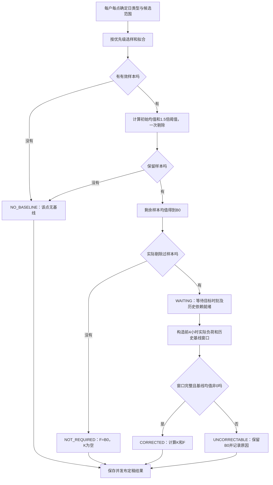

# 用户基线计算逻辑与产出说明

更新日期：2026-10-20。代码依据：`1d899f5`，并纳入本次讨论最终确认的业务口径。示例时间按北京时间表示。

本文集中说明典型日选取、缺失数据拟合、异常高值剔除、实时滚动修正、结果状态、任务统计，以及程序最终保存哪些数据。示例为人工设定输入，经当前Java计算器和窗口构造方法核算，不是实际运行环境导出的生产数据；示例ID和执行时间用于说明关联关系。

## 1. 交付范围与最终口径

计算单位是**一个营销户号、一个业务日期、一个15分钟点**。当前阶段只输出每户结果，不汇总聚合单元，也不计算聚合单元统一K。

最终确认的口径：

| 项目 | 口径 |
|---|---|
| 典型日选取 | 按户号、按点选择；不同用户、不同点允许选出不同日期 |
| 普通日样本数量 | 最多5个；范围内有几天算几天；一个也没有才是该点无基线 |
| 查询范围 | 工作日前30个工作日，公休日前20个公休日，不延长 |
| 参与日期 | 聚合单元级实际参与记录，同单元用户共用日期标记 |
| 样本优先级 | 正常真实值→正常拟合值→参与日真实值→参与日拟合值 |
| 拟合含义 | 直接复制符合规则的已有负荷值，不做线性插值 |
| 负荷值 | 正常业务场景为非负负荷；0有效，不能当成缺失 |
| 异常剔除 | 每户每点一次性剔除，使用剔除前均值的1.5倍阈值 |
| 修正开关 | 只有该户该点实际剔除过异常样本，且B0有效，才计算K |
| K | 每户单独计算，无上下限 |
| 滚动历史 | 使用已经输出的历史最终基线；初始化有独立规则 |
| 数值精度 | 接受当前精度处理，最终按6位小数向零截断保存 |
| 已输出结果 | 不因后补负荷重新计算；新数据只影响后续未计算的点 |
| 执行方式 | 按当前单实例、同一任务不重叠执行的定时任务方式运行 |

原始基线`B0`指**完成选样、拟合和异常剔除后，尚未乘K的均值**，不是剔除前均值。

## 2. 输入、日类型和时间点

### 2.1 程序读取的数据

| 输入 | 当前来源 | 用途 |
|---|---|---|
| 启用用户及归属 | `ra_aggregate_user` | 确定计算户号及所属聚合单元 |
| 历史、实际负荷 | TDengine `st_user_load_96` | 选样、拟合、实际负荷窗口 |
| 日历 | MySQL `ra_calendar_day` | 日类型、节日类型、假期分组和具体节日标签 |
| 实际参与日期 | `ra_adjustment_day`中`participate=true`的日期 | 普通日正常/参与日分类，节假日候选排除 |
| 已输出历史基线 | TDengine `st_user_baseline_load` | K的历史基线窗口 |
| 初始化窗口 | `ra_user_baseline_initial_window` | 首次历史最终基线不足时使用的B0种子 |

当前没有电量输入，因此不执行“电量÷时长”的拟合。所有参与计算的负荷统一按MW处理。

负荷读取会忽略空负荷，0仍保留；日期/时间缺失、业务日期解析失败或点序号不合法的源记录不作为选样值。业务日缺少日历，或根本没有可用候选日历范围时，当前程序报生成异常，不把这种配置缺失当成负荷为0或业务无基线。

日类型以日历表为准：

- `WORKDAY`：工作日，包含调休上班的周末。
- `RESTDAY`：普通公休日，不包含法定假期。
- `HOLIDAY`：元旦、春节、清明、劳动、端午、中秋、国庆等法定假期。

节假日需要区分节日类型、该次连休组及具体日期的节日标签，不能仅凭星期判断，也不能仅凭假期名称推测中秋是哪一天。当前日历同步使用随服务发布的本地JSON；人工覆盖记录不会被同步任务覆盖。

原文还提到“已执行负荷管理措施”的日期排除，但资料没有定义其判定来源及与实际参与记录的关系。本文按当前已接入的实际参与记录说明代码行为，不自行添加另一种独立标记，也不将这项资料缺口描述成已经验证覆盖。

### 2.2 一天96点

时点表示15分钟区间终点：

| 点序号 | 时间戳 | 对应区间 |
|---|---|---|
| 1 | 当日00:15 | 当日00:00—00:15 |
| 41 | 当日10:15 | 当日10:00—10:15 |
| 96 | 次日00:00，即业务日24:00 | 业务日23:45—24:00 |

第96点的`data_date`仍属于前一个业务日。例如业务日期2026-10-20的第96点，`target_time=2026-10-21 00:00:00`。

## 3. 整体计算流程



每日任务先为启用户号生成96点MySQL明细。未发生异常剔除的点可以直接定稿；需要修正的点保留`WAITING`，到各自目标时刻执行修正。

## 4. 工作日、公休日的典型日选取

### 4.1 先固定日期范围

目标业务日期为D，向前取同类型日期：

- D为工作日：固定前30个工作日。
- D为公休日：固定前20个公休日。

这里是30个工作日/20个公休日，不是30/20个自然日。

先确定完整范围，再处理参与、缺失等情况。被跳过的日期仍占用范围位置，不因为缺数据或参与调节而向范围外延长。拟合来源和参与日补足也不能越过这个范围。

### 4.2 四遍取样

在固定范围中，对当前户号的当前时点执行下表。每遍都从近到远，总样本达到5个即停止。

| 顺序 | 目标日期 | 取值方法 |
|---|---|---|
| 1 | 未实际参与的日期 | 取该点已有负荷；缺失先跳过 |
| 2 | 第一遍跳过的未参与日期 | 按同类型日、同一时点向前拟合 |
| 3 | 实际参与的日期 | 取该点已有负荷；缺失先跳过 |
| 4 | 第三遍跳过的参与日期 | 按同类型日、同一时点向前拟合 |

“正常拟合值”优先于“参与日真实值”；参与日内部仍然先真实、后拟合。

整日没有数据的普通日不提前排除，仍能进入第二遍或第四遍拟合。用户甲某日该点不可用，不影响用户乙或同一天其他点。

### 4.3 典型点拟合

目标典型日期d的10:15缺失时，从d之前的同类型日期开始，按时间倒序寻找该户10:15的真实负荷：

1. 找到最近一个有效值就复制使用，0也有效。
2. 来源日期允许实际参与过调节；原讨论也允许执行过负荷管理的日期作为缺失点来源。
3. 如果来源日该点也缺失，继续向前，直到找到或达到本次固定范围边界。
4. 只补同一时点，不能用该典型日10:00或10:30替代10:15。

同一目标日期只入选一次；不同目标日期可以引用同一个来源日期。需要分别保存目标日期、来源日期和是否拟合，不能把这些样本标成多个独立真实观测。

最终数量N为1—5时，直接用N个样本继续计算；N=0时只将当前户号当前点标记为无基线。

## 5. 节假日的典型日选取

### 5.1 按假期组逐级尝试

每户每点分别执行：

```text
上一年同类型节假日
    ↓ 当前点没有有效样本
当年、本次假期之前的其他假期，按由近到远逐组尝试
    ↓ 这些假期当前点均没有有效样本
目标日前20个公休日，采用普通日四遍取样规则
```

不使用本次假期尚未发生的日期。某一假期组只要在当前户号当前点取得至少1个有效样本，就使用这一组全部有效样本并停止，不再拼接其他假期组凑满5天。

节假日组的有效样本可以超过5个；只有回退公休日时才使用“最多5个、范围20个公休日”的规则。

### 5.2 每个假期组内部筛选

- 排除实际参与日期。
- 排除该用户整日完全没有有效负荷数据的日期。
- 某日只是部分点缺失：保留该日期，对缺失点拟合。
- 拟合后仍无值，只跳过该日当前点，不使整组或该用户全天作废。
- 是否切换下一个假期组，按当前点在异常剔除前是否取得样本判断；异常剔除后不重新选样。

节假日缺失点允许跨假期向前查找：枚举被补日期之前的节假日，按完整日期倒序寻找该用户同一时点的真实负荷，找到最近可用值就停止，不另设未确认的年份或天数限制。

注意区别：为去年国庆某天补一个点，可以引用更早节假日的同点值；这仍是“去年国庆目标日期的拟合样本”，不等于把整个典型假期改成来源假期。

### 5.3 国庆、中秋合并情况

当年国庆与中秋分开、上一年合并时，从上一年国庆候选日期中去掉有中秋具体日期标签的当天。当前年也合并时，不套用这一特殊排除。

该排除只作用于目标典型日期，不禁止该日期按已确认规则作为更晚缺失日期的拟合来源。拟合来源始终全局按日期倒序，不能按同名假期跨年拼接后改变先后顺序。

当前代码遇到需要特殊排除的合并组、却没有任何中秋具体日期标签时，会跳过该候选组。因此真实日历的标签完整性会直接影响结果，应在数据准备时保证准确。

## 6. 异常高值剔除与原始基线

对当前户号、当前点，选出N个有效样本`S={x1,…,xN}`：

```text
初始均值 M = (x1 + … + xN) / N
异常阈值 T = 1.5 × M
剔除集合 E = {x ∈ S | x > 0 且 x > T}
保留集合 R = S去掉E
原始基线 B0 = sum(R) / count(R)
```

正常业务按非负负荷处理，保留现有正值剔除条件。0是有效值。严格大于阈值才剔除，等于阈值保留。

阈值只计算一次：不边剔除边反复算阈值，不补选新日期，也不把原来5个样本重新补满。

| 情况 | 处理 |
|---|---|
| 原本没有有效样本 | `NO_BASELINE`，B0和F为空 |
| 剔除后没有保留样本 | `NO_BASELINE`，B0和F为空，记录原因 |
| 没有剔除样本 | `NOT_REQUIRED`，F=B0，K为空 |
| 有剔除且B0有效 | `WAITING`，保存B0，等待目标时刻修正 |

例如`10、11、12、13、30`：M=15.2，T=22.8，剔除30，B0=(10+11+12+13)/4=11.5。

## 7. 实时滚动修正

### 7.1 前4小时窗口

目标点为t，窗口成员为：

```text
W(t) = {t−4小时, t−3小时45分, …, t−15分钟}，共16点
```

例如10:15的窗口是06:15、06:30、……、10:00，表示06:00—10:00的16个15分钟负荷区间。当前点10:15不作为窗口成员。

每户独立构造两条序列：

- 实际序列A：窗口内各点实际负荷，缺失时按第7.2节补全。
- 基线序列H：窗口内各点已经输出的最终基线，缺失时按第7.3节补全。

不从实际窗口剔除已经参与调节的时段。后续如有出清结果，再另行明确调整规则。

### 7.2 实际负荷缺失拟合

针对窗口中某个缺失点s，按以下顺序直接取首个有效值：

```text
s−15分钟 → s+15分钟 → s−30分钟 → s+30分钟 → … → 前后各240分钟
```

同距离前值优先；不平均、不插值。当前实现读取`t−8小时`至`t`的实际负荷，包含t但不使用t之后的值。

窗口成员不含t，但若t点实际负荷已经到达，可以作为某个缺失历史点的后向拟合来源。补值可以来自窗口起点之前；均值仍只统计窗口内16个目标点，不增加窗口成员数量。

达到查找边界仍无有效来源，该窗口无法补齐。

### 7.3 历史基线缺失与首次初始化

已存在、已输出的历史最终基线优先使用。某历史点没有有效最终值时，使用最近有效前值；基线补全不向后找，也不拿实际负荷替代。

首次确实需要历史基线初始化时，按该户首次窗口16个完整时点各自的业务日期、日类型和点序号，分别计算B0，并保存到初始化窗口表。只初始化一次，重启复用同一窗口，不每天重新初始化。

当前窗口构造的使用顺序为：

1. 该历史时点有已输出最终值，直接使用。
2. 当前点初始化种子有效时：若有此前已输出有效最终值，先沿用其最近前值；否则使用该点种子。
3. 当前点种子也无效时：比较可用的此前已输出最终值和此前有效初始化种子，采用来源时间最近的前值；同一来源时间优先已输出最终值。
4. 没有任何允许的来源，基线窗口无法补齐。

补值只供本次窗口使用，不覆盖历史正式结果或初始化记录。0也可以作为有效前值。

示例：计算2026-10-20的00:15，窗口首点是2026-10-19 20:15、第81点；末点是2026-10-20 00:00，但业务日期为2026-10-19、第96点。不能拿2026-10-20白天同一钟点的B0替代前一天。

### 7.4 前序结果未完成时等待

计算前先查询MySQL中该户、同一算法版本、前4小时内已有明细。若存在：

- `WAITING`历史点；或
- 已定稿但尚未同步TDengine的历史点；

则当前点等待重试，保持`WAITING`，不把前序尚未完成当成普通缺失来拟合，也不立即判为无法修正。

原本没有历史明细的点，继续按首次初始化及前值补全规则处理。已经同步的`NO_BASELINE`历史点则作为已完成但缺值的情况进行补全。

### 7.5 K和最终基线公式

两条窗口补齐后：

```text
实际均值 Amean = sum(实际窗口16点) / 16
基线均值 Hmean = sum(历史最终基线窗口16点) / 16
K = Amean / Hmean
最终基线 F = 当前点未修正的B0计算值 × K计算值
```

每户单独计算，无K上下限。不能用聚合单元统一K，也不能把当前点已经修正过的F再次乘K。

如果先按每小时4个点求均值，再对4个小时均值求平均，在16点都已补齐的条件下，与上述16点直接求均值等价。

10:30重新取06:30—10:15的16点窗口，其中10:15基线使用该户已经输出的最终值，不再使用它的修正前B0。

### 7.6 无法修正

只有实际发生过异常剔除、需要修正的点，才进入这些判断：

| 情况 | 结果 |
|---|---|
| 实际或基线窗口按规则仍无法补齐 | F保留B0、K为空，`UNCORRECTABLE`，记录缺失窗口及首个无法补齐的时点 |
| 两类窗口同时无法补齐 | 同时记录两项原因 |
| 窗口齐全但Hmean=0 | F保留B0、K为空，`UNCORRECTABLE`，记录分母为0 |
| Amean=0且Hmean非0 | 正常计算K=0、F=0，`CORRECTED` |
| 两条窗口齐全且Hmean非0 | 正常计算K和F，`CORRECTED` |

`UNCORRECTABLE`是当前点的业务处理结果，不代表系统执行失败；定稿后不等待新负荷到来重新计算。

当前计算器在无法修正时将K及两个均值字段均保存为`null`，即使某条窗口的均值可以单独算出，也不单独落到均值字段。已有窗口取值仍保留在JSON中，原因说明用于解释无法修正条件。

## 8. 精度、保存和发布

计算器使用BigDecimal高精度运算。当前实现将B0、窗口均值、K、F按6位小数向零截断，接受这一现有精度处理，不另设过程精度验收口径。修正乘法使用保存前的计算值，而不是先把保存后的六位K再乘一次B0。

MySQL的`raw_baseline_calc_mw`保留更多位用于计算，表结构为DECIMAL(24,12)；B0、均值、K、F对应DECIMAL(24,6)。

TDengine按以下方式保存数值：

```text
整数存储值 = 六位小数值 × 1,000,000
显示值 = 整数存储值 ÷ 1,000,000
```

Java恢复显示值时用`BigDecimal.valueOf(整数值, 6)`。K是无量纲比值，其余负荷和均值为MW。

| 实际值 | TDengine整数 |
|---|---:|
| B0=11.500000 MW | 11500000 |
| K=0.800000 | 800000 |
| F=9.200000 MW | 9200000 |
| 0.000000 | 0 |
| 无值 | null，不能替换为0 |

程序先保存MySQL计算明细。**TDengine只接收定稿状态**：`NOT_REQUIRED`、`NO_BASELINE`、`CORRECTED`、`UNCORRECTABLE`；`WAITING`不提前发布。

发布前按明细ID读取已经保存的定稿结果。写入TDengine成功后，再按具体ID、版本、发送时的定稿状态确认`SYNCED`。写入或确认失败时重放同一结果，不重新计算K，也不整日删除重写。

因此每天凌晨MySQL可以已经有96点明细，TDengine却暂时少于96点：缺少的可能是正常等待目标时刻修正的点。查询待修正原始基线应读MySQL，不能把TDengine暂时没有该点解释成已判定无基线。

## 9. 程序产生的数据

### 9.1 表和数据粒度

| 保存位置 | 粒度 | 主要内容 |
|---|---|---|
| `ra_calendar_day` | 每个自然日一条 | 日类型、节日类型、假期组、具体节日标签、来源及人工覆盖信息 |
| `ra_user_baseline_run` | 每业务日、每算法版本一条 | 当天生成任务、用户数量统计、执行状态和时间 |
| `ra_user_baseline_detail` | 每户、每业务日、每点、每算法版本一条 | 样本、剔除、B0、窗口、K、F、原因、发布状态 |
| `ra_user_baseline_correction_task` | 每业务日、每需修正时点、每版本一条 | 同一时点需要修正的用户总数、处理数量、执行与重试状态 |
| `ra_user_baseline_initial_window` | 每户、每版本至多一条 | 有需要时保存首次16点B0初始化窗口；不一定每户都会产生 |
| TDengine `st_user_baseline_load` | 每户、每时点的定稿行 | 最终查询结果及B0、均值、K、状态、原因和追踪编码 |

一个户号固定对应一张TDengine子表，子表名为`user_baseline_`加户号SHA-256前24个十六进制字符。标签是`cons_no`，业务日期为数据列。聚合单元归属只保存在MySQL相关明细中，不产生本阶段聚合结果。

### 9.2 用户逐点明细字段

以下使用数据库列名；Java实体为相应的驼峰字段名。

| 字段 | 含义 |
|---|---|
| `id`、`run_id` | 明细ID、对应每日生成运行ID |
| `cons_no`、`unit_id` | 户号、计算时所属聚合单元 |
| `data_date`、`slot_no`、`target_time`、`day_type` | 业务日期、点序号、完整时点、日类型 |
| `sample_detail_json` | 入选样本；含目标日期、来源日期、点、取值、类别、是否拟合、负荷来源类型 |
| `initial_mean_mw`、`threshold_mw` | 剔除前均值、1.5倍阈值 |
| `removed_sample_json`、`removed_count` | 被剔除样本及数量 |
| `raw_baseline_calc_mw`、`raw_baseline_mw` | B0计算值、六位B0保存值 |
| `need_correction` | 是否实际发生过异常样本剔除 |
| `actual_window_json`、`baseline_window_json` | 本次实际使用的窗口目标时点、来源时点、值、说明、方向和距离 |
| `actual_window_mean_mw`、`baseline_window_mean_mw` | 成功修正时两个窗口的均值 |
| `k_value`、`final_baseline_mw` | K、最终基线F |
| `correction_status`、`calculation_remark` | 计算状态、中文计算与原因说明 |
| `snapshot_time`、`generated_at`、`corrected_at` | 生成读取时间标记、原始基线生成时间、修正处理时间 |
| `sync_status`、`synced_at` | TDengine发布状态、发布确认时间 |
| `trace_code`、`calc_version` | 跨库追踪编码、算法版本 |

表还包括通用创建、修改、逻辑删除等字段，不属于计算数值。`snapshot_time`是当前实现的时间标记，不能据此宣称已经实现历史数据版本查询；现有窗口JSON保存实际取值和来源时间，没有额外的源记录版本字段。

### 9.3 五种计算状态

| 状态 | B0 | K | `final_baseline_mw` | 是否定稿并允许发布 |
|---|---|---|---|---|
| `NO_BASELINE` | null | null | null | 是，发布无基线状态 |
| `NOT_REQUIRED` | 有值 | null | B0 | 是 |
| `WAITING` | 有值 | null | 初始保存时暂存B0，尚未定稿 | 否 |
| `CORRECTED` | 有值 | 有值 | B0×K | 是 |
| `UNCORRECTABLE` | 有值 | null | 保留B0 | 是 |

同步状态独立：`PENDING`表示尚未确认同步，`SYNCED`表示已确认。`WAITING/PENDING`本身是正常中间状态。

## 10. 统计与完成判定

### 10.1 每日生成统计

| 字段/返回值 | 单位和口径 |
|---|---|
| `total_user_count` / `total` | 生成开始时查询到的启用用户记录数，当前代码使用记录COUNT |
| `success_user_count` / `success` | 本轮成功完成96点明细准备，并成功发布本轮需要立即发布的定稿点的用户数 |
| `failed_user_count` / `failed` | 用户计算、保存或发布等执行失败数量；整体异常时还有运行记录失败数的兜底更新 |
| `correctionPoints` | 持久化明细中`need_correction=true`的户号点数总和，重试统计也包含此前已完成修正的这类明细 |

`correctionPoints`不是独立时刻数量，也不是剩余待办数量，不保存在run表的同名列。它由生成方法返回并写入任务日志。

正常返回时`total=success+failed`。整体异常会抛出异常，不返回正常的UserBaselineJobResult，运行记录仍保存当前统计和错误。

用户某点为`NO_BASELINE`仍是一次成功执行的业务结果；不能因此把该用户计入系统生成失败。需要修正的点仍为`WAITING`，也不妨碍原始基线生成任务成功结束。

每日状态包括`RUNNING`、`SUCCESS`、`PARTIAL_FAILED`、`FAILED`。生成任务`SUCCESS`不表示当天所有点都已经完成实时修正。

### 10.2 时刻级修正任务统计

同一天、同一版本、同一点只建立一个修正任务，任务内包含多个户号。

| 字段 | 口径 |
|---|---|
| `total_count` | 该点全部需要修正的用户明细数 |
| `success_count` | `CORRECTED`且`SYNCED`的用户数 |
| `failed_count` | 当前任务完成统计中的`UNCORRECTABLE`且`SYNCED`用户数 |
| `retry_count` | 进入系统重试的次数，不能当作无法修正用户数；前序未就绪导致的等待重试也会进入此流程 |
| `status` | `PENDING`、`PROCESSING`、`RETRY_WAIT`、`SUCCESS` |

标记任务`SUCCESS`前要求：

```text
WAITING数量 = 0
待同步的修正定稿数量 = 0
success_count + failed_count = total_count
```

因此任务可以是`SUCCESS`且`failed_count>0`：表示所有用户都已处理并发布，其中部分用户按规则无法修正、已经保留B0。

修正调度方法返回/日志中的完成数量，是完成的时刻级任务数量，不是完成的用户数。

### 10.3 可从明细统计的业务指标

样本数N、被剔除数量、正常/拟合样本数量可从对应JSON和字段获得；有效最终点数可以按`final_baseline_mw IS NOT NULL`统计，0也算有效。

按状态统计的每日点数、有效基线覆盖率等可以由明细汇总得出，但当前代码没有另外生成这些报表表或HTTP接口，下面示例中的状态分布是据明细推导的结果。

## 11. 贯穿示例：4户、同一个10:15点

### 11.1 场景

业务日期2026-10-20，目标10:15，第41点，版本V1；4个启用户号A001、B002、C003、D004，示例归属G1，主例典型日期均按工作日、未参与处理。

为了说明统计，假设这4户其他95点都正常取得B0且无需修正。其中A001前4小时16点最终基线均为12.5，C003前4小时16点最终基线均为0，且已经发布。D004只是当前10:15没有样本，不是全天没有数据。

### 11.2 典型日输入与剔除

| 目标典型日期 | A001 | B002 | C003 | D004 |
|---|---:|---:|---:|---|
| 2026-10-19 | 10 | 4 | 10 | 无可用样本 |
| 2026-10-16 | 11 | 5 | 11 | 无可用样本 |
| 2026-10-15 | 12 | 6 | 12 | 无可用样本 |
| 2026-10-14 | 13 | 7 | 13 | 无可用样本 |
| 2026-10-13 | 30 | 8 | 30 | 无可用样本 |

D004在整个允许范围内经过选样、拟合、补足后，该点仍没有有效样本。表中各负荷单位均为MW。

| 计算项 | A001 | B002 | C003 | D004 |
|---|---:|---:|---:|---|
| 样本数 | 5 | 5 | 5 | 0 |
| 初始均值M | 15.2 | 6 | 15.2 | null |
| 阈值1.5M | 22.8 | 9 | 22.8 | null |
| 剔除样本 | 2026-10-13的30 | 无 | 2026-10-13的30 | 无 |
| 剔除数量 | 1 | 0 | 1 | 0 |
| B0 | 11.5 | 6 | 11.5 | null |
| 生成后的状态 | WAITING | NOT_REQUIRED | WAITING | NO_BASELINE |

### 11.3 A001实际窗口及拟合

A001在06:30缺少实际负荷。前15分钟06:15有8，后15分钟06:45有12，同距离优先前值，因此06:30采用8，不取12，也不取两者平均值。

| 窗口点 | 实际原始值 | 本次采用实际值 | 实际来源时间 | 历史最终基线 |
|---|---:|---:|---|---:|
| 06:15 | 8 | 8 | 06:15 | 12.5 |
| 06:30 | null | 8 | 06:15，前值拟合 | 12.5 |
| 06:45 | 12 | 12 | 06:45 | 12.5 |
| 07:00 | 12 | 12 | 07:00 | 12.5 |
| 07:15 | 10 | 10 | 07:15 | 12.5 |
| 07:30 | 10 | 10 | 07:30 | 12.5 |
| 07:45 | 10 | 10 | 07:45 | 12.5 |
| 08:00 | 10 | 10 | 08:00 | 12.5 |
| 08:15 | 10 | 10 | 08:15 | 12.5 |
| 08:30 | 10 | 10 | 08:30 | 12.5 |
| 08:45 | 10 | 10 | 08:45 | 12.5 |
| 09:00 | 10 | 10 | 09:00 | 12.5 |
| 09:15 | 10 | 10 | 09:15 | 12.5 |
| 09:30 | 10 | 10 | 09:30 | 12.5 |
| 09:45 | 10 | 10 | 09:45 | 12.5 |
| 10:00 | 10 | 10 | 10:00 | 12.5 |

```text
实际窗口合计 = 8+8+12+12+12×10 = 160
Amean = 160/16 = 10
历史基线合计 = 16×12.5 = 200
Hmean = 200/16 = 12.5
K = 10/12.5 = 0.8
F = 11.5×0.8 = 9.2 MW
```

### 11.4 其余三户处理

- B002没有剔除样本，不读取修正窗口，不计算K，最终F=6。
- C003需要修正，但其历史窗口16点都为有效的0，均值为0，不能作分母，最终保留B0=11.5，标记无法修正及原因。它不是窗口缺失。
- D004本点无有效样本，B0和F均为空，标记无基线，不进入K计算。

### 11.5 最终用户点结果

| 户号 | B0/MW | 实际均值/MW | 基线均值/MW | K | 最终基线/MW | 状态 | 说明 |
|---|---:|---:|---:|---:|---:|---|---|
| A001 | 11.500000 | 10.000000 | 12.500000 | 0.800000 | 9.200000 | CORRECTED | 剔除30后，按窗口乘K |
| B002 | 6.000000 | null | null | null | 6.000000 | NOT_REQUIRED | 未发生剔除，不修正 |
| C003 | 11.500000 | null | null | null | 11.500000 | UNCORRECTABLE | 历史基线窗口均值为0，保留B0 |
| D004 | null | null | null | null | null | NO_BASELINE | 本点无有效样本 |

C003的窗口JSON可以显示16个0，但均值字段按当前无法修正分支仍为null。B002的均值字段为空是因为根本不需要修正，两者含义不同。

这些是4个用户各自的结果，本阶段不再把9.2、6、11.5相加生成G1聚合基线。

## 12. 上述例子实际保存哪些数据

### 12.1 MySQL逐点明细：A001标量字段

以下以数据库字段展开显示，JSON字段在下一节展示；不是新增HTTP接口格式。

```json
{
  "id": 10001,
  "run_id": 9001,
  "data_date": "2026-10-20",
  "slot_no": 41,
  "target_time": "2026-10-20 10:15:00",
  "cons_no": "A001",
  "unit_id": "G1",
  "day_type": "WORKDAY",
  "initial_mean_mw": 15.200000000000,
  "threshold_mw": 22.800000000000,
  "removed_count": 1,
  "raw_baseline_calc_mw": 11.500000000000,
  "raw_baseline_mw": 11.500000,
  "need_correction": true,
  "actual_window_mean_mw": 10.000000,
  "baseline_window_mean_mw": 12.500000,
  "k_value": 0.800000,
  "final_baseline_mw": 9.200000,
  "correction_status": "CORRECTED",
  "calculation_remark": "取得5个样本，初始均值15.2，阈值22.8；剔除2026-10-13的30，B0=11.5。前4小时实际均值10、历史最终基线均值12.5，K=0.8，最终基线9.2兆瓦。",
  "trace_code": "e96632ef46b89619ced198e6ea0c62f64f7ae81e0795de5ea64d326456379364",
  "snapshot_time": "2026-10-20 00:00:00.000",
  "generated_at": "2026-10-20 00:01:00.000",
  "corrected_at": "2026-10-20 10:15:02.000",
  "sync_status": "SYNCED",
  "synced_at": "2026-10-20 10:15:04.000",
  "calc_version": "V1"
}
```

中文说明为便于阅读的缩写，实际程序会拼接更完整的样本和公式说明。trace_code按`A001|2026-10-20|41|V1`的SHA-256计算，与代码一致。

### 12.2 样本及剔除JSON

`sample_detail_json`中的5个样本全部保留，包括后续被剔除的样本：

```json
[
  {"targetDate":"2026-10-19","sourceDate":"2026-10-19","slotNo":41,"value":10,"sourceCategory":"正常真实值","fitted":false,"sourceType":"人工维护负荷"},
  {"targetDate":"2026-10-16","sourceDate":"2026-10-16","slotNo":41,"value":11,"sourceCategory":"正常真实值","fitted":false,"sourceType":"人工维护负荷"},
  {"targetDate":"2026-10-15","sourceDate":"2026-10-15","slotNo":41,"value":12,"sourceCategory":"正常真实值","fitted":false,"sourceType":"人工维护负荷"},
  {"targetDate":"2026-10-14","sourceDate":"2026-10-14","slotNo":41,"value":13,"sourceCategory":"正常真实值","fitted":false,"sourceType":"人工维护负荷"},
  {"targetDate":"2026-10-13","sourceDate":"2026-10-13","slotNo":41,"value":30,"sourceCategory":"正常真实值","fitted":false,"sourceType":"人工维护负荷"}
]
```

`removed_sample_json`：

```json
[
  {"targetDate":"2026-10-13","sourceDate":"2026-10-13","slotNo":41,"value":30,"sourceCategory":"正常真实值","fitted":false,"sourceType":"人工维护负荷"}
]
```

### 12.3 窗口JSON中的补值记录

实际保存完整16条。下例只截取06:15、06:30两条，其他14条对应第11.3节的窗口表：

```json
[
  {
    "targetTime":"2026-10-20T06:15:00",
    "sourceTime":"2026-10-20T06:15:00",
    "value":8,
    "sourceDescription":"采用目标时点真实负荷，来源类型：人工维护负荷",
    "direction":"当前点",
    "distanceMinutes":0
  },
  {
    "targetTime":"2026-10-20T06:30:00",
    "sourceTime":"2026-10-20T06:15:00",
    "value":8,
    "sourceDescription":"目标时点缺失，采用前方已有真实负荷，来源类型：人工维护负荷",
    "direction":"前值",
    "distanceMinutes":15
  }
]
```

`baseline_window_json`也保存16条，主例每条值为12.5，targetTime与sourceTime相同，说明为采用该历史时点已输出的最终基线。

### 12.4 TDengine四条最终行

这里只展示计算和识别字段；实际还包含中文说明、trace_id、生成和修正时间。

| cons_no | ts | slot_no | raw_baseline_e6 | actual_window_mean_e6 | baseline_window_mean_e6 | k_e6 | final_baseline_e6 | correction_status |
|---|---|---:|---:|---:|---:|---:|---:|---|
| A001 | 2026-10-20 10:15:00 | 41 | 11500000 | 10000000 | 12500000 | 800000 | 9200000 | CORRECTED |
| B002 | 2026-10-20 10:15:00 | 41 | 6000000 | null | null | null | 6000000 | NOT_REQUIRED |
| C003 | 2026-10-20 10:15:00 | 41 | 11500000 | null | null | null | 11500000 | UNCORRECTABLE |
| D004 | 2026-10-20 10:15:00 | 41 | null | null | null | null | null | NO_BASELINE |

4条行的`data_date`均为2026-10-20、`calc_version`均为V1。A001的子表名是`user_baseline_8e7d97a738983490f8d9e266`，`trace_id`与MySQL的`trace_code`相同。

没有完整样本和窗口JSON写入TDengine；这些追溯细节保存在MySQL。TDengine保留结果、均值、K、状态和中文说明。

### 12.5 每日生成运行记录和返回统计

```json
{
  "id":9001,
  "data_date":"2026-10-20",
  "calc_version":"V1",
  "status":"SUCCESS",
  "total_user_count":4,
  "success_user_count":4,
  "failed_user_count":0,
  "snapshot_time":"2026-10-20 00:00:00.000",
  "started_at":"2026-10-20 00:00:00.000",
  "finished_at":"2026-10-20 00:02:00.000",
  "error_message":null
}
```

方法返回的UserBaselineJobResult可表示为：

```json
{"total":4,"success":4,"failed":0,"correctionPoints":2}
```

运行记录还包含执行令牌、租约、心跳和通用审计字段；上例省略这些运行控制字段。这里成功4户，因为4户都成功生成业务结果，D004一个点无基线不算程序失败。

### 12.6 10:15修正任务记录

A001、C003两个户号都需要修正，属于同一条任务：

```json
{
  "id":9010,
  "data_date":"2026-10-20",
  "slot_no":41,
  "target_time":"2026-10-20 10:15:00",
  "scheduled_time":"2026-10-20 10:15:00",
  "calc_version":"V1",
  "status":"SUCCESS",
  "total_count":2,
  "success_count":1,
  "failed_count":1,
  "retry_count":0,
  "last_error":null,
  "completed_at":"2026-10-20 10:15:05.000"
}
```

任务完成数量是1条，处理用户数是2户；成功修正1户，无法修正并保留B0为1户。`last_error=null`，因为C003属于业务无法修正，不是系统异常。

### 12.7 全天结果数量

在本例其他95点都无需修正的假设下：

| 时刻/指标 | 数量 |
|---|---:|
| 每日MySQL用户逐点明细 | 4×96=384条 |
| 凌晨生成后NOT_REQUIRED | 381点 |
| 凌晨生成后NO_BASELINE | 1点 |
| 凌晨生成后WAITING | 2点 |
| 凌晨已发布TDengine | 382条，含1条无基线状态行 |
| 10:15修正后CORRECTED | 1点 |
| 10:15修正后UNCORRECTABLE | 1点 |
| 全部定稿且发布后TDengine | 384条 |
| 最终有数值的基线点 | 383点，包含值为0的点 |
| 最终无基线点 | 1点 |

最终状态分布为NOT_REQUIRED=381、CORRECTED=1、UNCORRECTABLE=1、NO_BASELINE=1，总计384。MySQL明细仍为384条，是原明细状态更新，不为修正再增加第二套逐点明细。

## 13. 补充例子：其他重要分支

以下是独立场景，不改变第11—12节主例的数据和统计。

### 13.1 正常拟合优于参与日真实值

假定固定工作日范围内仅以下日期能提供当前点样本或拟合来源，其余正常日期均无法补齐：

| 日期 | 是否参与 | 10:15真实值 |
|---|---|---:|
| 2026-10-19 | 否 | 10 |
| 2026-10-16 | 否 | 缺失 |
| 2026-10-15 | 否 | 11 |
| 2026-10-14 | 否 | 12 |
| 2026-10-13 | 否 | 13 |
| 2026-10-12 | 是 | 30 |

第一遍选4个正常真实样本10、11、12、13；第二遍把10月16日缺失点引用10月15日的11，达到5个，停止，不使用参与日的30。

```text
样本 = 10、11、12、13、11
M = 57/5 = 11.4
阈值 = 17.1
没有异常剔除
B0 = F = 11.400000，K=null，NOT_REQUIRED
```

拟合样本的追溯内容为：

```json
{"targetDate":"2026-10-16","sourceDate":"2026-10-15","slotNo":41,"value":11,"sourceCategory":"正常拟合值","fitted":true,"sourceType":"人工维护负荷"}
```

### 13.2 范围内不足5天

前20个公休日经过全部四遍取样，只取得3个值`8、10、12`：M=10，阈值15，无剔除，B0=F=10。不会向第21个公休日继续找，也不会因为只有3个样本把该点判为无基线。

### 13.3 合并假期与逐点回退

假定今年国庆和中秋分开，去年合并假期在某点只有3个可用候选值：国庆日期100、200，中秋当天300。按标签排除中秋目标日期后，使用100、200。

```text
M = 150，阈值 = 225
不再剔除，B0 = F = 150，K=null
```

如果去年该点完全没有有效样本，最近当年假期该点只有10、20两个有效样本，就使用这2天：B0=F=15，不再拼接更早假期。其他点仍可以使用各自有效的去年同类假期，不必跟着这个点一起回退。

若所有候选假期都不可用，回退前20个公休日。例如只取得10、20两个有效值，则B0=F=15；如果公休日四遍取样也一个都没有，该点为NO_BASELINE。

### 13.4 历史基线缺失的前值补全

假定09:00历史点已经处理并同步，但最终值为空；08:45有已输出最终值12.5。计算10:15窗口时，09:00采用08:45的12.5，记录目标09:00、来源08:45、前值、距离15分钟。历史09:00正式记录仍为空，不被补值覆盖。

如果09:00仍是WAITING，则当前点等待它完成，不能直接套用上述补全。

### 13.5 首次初始化记录

若户号E005首次在2026-10-20 00:15需要初始化，会按16个完整历史时点计算种子，并保存一条`ra_user_baseline_initial_window`，其`seed_window_json`里有16个对象：

| 字段/位置 | 示例 |
|---|---|
| `cons_no` | E005 |
| `calc_version` | V1 |
| `first_target_time` | 2026-10-20 00:15:00 |
| 第1个种子的`pointTime` | 2026-10-19 20:15:00 |
| 第1个种子的`dataDate`、`slotNo` | 2026-10-19、81 |
| 第16个种子的`pointTime` | 2026-10-20 00:00:00 |
| 第16个种子的`dataDate`、`slotNo` | 2026-10-19、96 |
| 每个种子的`rawResult` | 该历史点的初始均值、阈值、B0、完整样本和剔除结果、状态、原因 |

如果初始化时本来已有充足历史最终值，则不产生这条初始化记录。种子不能单独当作16条已发布的正式历史基线。

## 14. 代码定位

| 内容 | 文件 |
|---|---|
| 日期筛选、普通日四遍取样、假期回退、典型点拟合 | [TypicalSampleSelector.java](TypicalSampleSelector.java) |
| 初始均值、阈值、剔除、B0、K、F和截断 | [UserBaselinePointCalculator.java](UserBaselinePointCalculator.java) |
| 实际/基线窗口、历史依赖、修正处理 | [UserBaselineCorrectionService.java](UserBaselineCorrectionService.java) |
| 每日96点生成、每日统计、时刻任务统计 | [UserBaselineGenerationService.java](UserBaselineGenerationService.java) |
| 初始化历史日期和种子 | [UserBaselineInitialWindowService.java](UserBaselineInitialWindowService.java) |
| 事务内保存及定稿不可覆盖 | [UserBaselinePersistenceService.java](UserBaselinePersistenceService.java) |
| 统一发布和按明细确认 | [UserBaselinePublisher.java](UserBaselinePublisher.java)、[UserBaselineDetailMapper.java](UserBaselineDetailMapper.java) |
| 点序号、整数缩放、子表名、追踪码 | [UserBaselineStorageSupport.java](UserBaselineStorageSupport.java) |
| 源负荷读取边界、历史基线读取边界 | [UserBaselineSourceMapper.xml](UserBaselineSourceMapper.xml)、[UserBaselineLoadMapper.xml](UserBaselineLoadMapper.xml) |
| MySQL、TDengine字段 | [用户基线-mysql.sql](用户基线-mysql.sql)、[用户基线-tdengine.sql](用户基线-tdengine.sql) |

本文示例核算覆盖样本剔除、实际窗口拟合、基线窗口、K和F、无需修正、无法修正、无基线、整数缩放与追踪编码。统计示例按上述指定输入和当前计数逻辑推导，不表示已经完成真实数据库联调。
